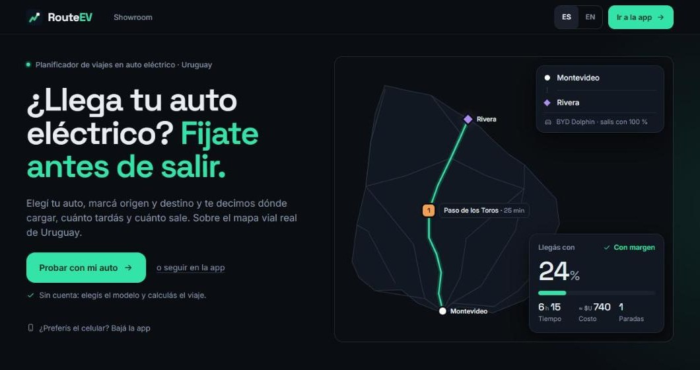

<p align="center">
  <picture>
    <source media="(prefers-color-scheme: dark)" srcset="https://raw.githubusercontent.com/routeev/.github/main/profile/assets/banner-dark.svg">
    
  </picture>
</p>

<p align="center">
  <a href="https://routeev.uy"></a>
  <a href="https://github.com/routeev/routeev-frontend/actions/workflows/ci.yml"></a>
  
  
  
</p>

<p align="center">
  <b>La web de <a href="https://routeev.uy">RouteEV</a>:</b> planificá tu viaje en auto eléctrico por Uruguay,<br>
  con las paradas de carga calculadas para tu auto y la batería con la que salís.
</p>

<p align="center">
  <a href="https://routeev.uy"></a>
</p>

## Qué hay acá

Este repo es el **frontend** de RouteEV: la landing, el mapa con el planificador de rutas, el showroom de autos eléctricos y el perfil de cada usuario. El cálculo de rutas, los datos de cargadores y las cuentas viven en la API (repo privado `routeev-backend`, servida en `api.routeev.uy`).

| | |
|---|---|
| 🗺️ **Planificador** (`/app`) | Origen, destino y auto: devuelve la ruta con las paradas de carga, la batería estimada en cada tramo, peajes y tiempos. Modos rápido, eficiente y económico. |
| 🔌 **Cargadores** | Los más de 260 cargadores del país en el mapa, con galería de fotos, reseñas, estado reportado por la comunidad y "Ir hasta acá" desde tu ubicación. |
| 📍 **Viaje en vivo** | Seguimiento con GPS y batería restante estimada en cada momento del viaje. |
| 🚗 **Showroom** (`/showroom`) | Catálogo de más de 300 modelos (587 versiones) y simulador para comparar autos en viajes reales entre ciudades. |
| 👤 **Perfil** (`/profile`) | Cuenta, vehículos propios e historial de viajes con estadísticas. |

## Empezar

Requiere **Node 24**.

```bash
npm install
npm run dev
```

Abre `http://localhost:5173`. No hace falta `.env`: en desarrollo, Vite reenvía `/api` a la API de producción (ver `vite.config.ts`). Para apuntar a otra API, por ejemplo una local, copiá `.env.example` a `.env` y definí `VITE_API_BASE_URL`.

## Scripts

| Comando | Qué hace |
|---|---|
| `npm run dev` | Servidor de desarrollo con HMR |
| `npm run build` | Type-check (`tsc -b`, incluye los tests) + build de producción |
| `npm run preview` | Sirve el build de `dist/` localmente |
| `npm test` / `npm run test:watch` | Vitest (una corrida / modo watch) |
| `npm run lint` | ESLint |
| `npm run format` / `format:check` | Prettier |

## Stack

| Capa | Tecnología |
|---|---|
| UI | React 19 + TypeScript, CSS Modules (sin frameworks de CSS), tokens de diseño propios |
| Ruteo | React Router 7, con code-splitting por página |
| Datos | TanStack Query (servidor) + Zustand (estado del mapa) |
| Mapa | Leaflet + react-leaflet, con mapa base vectorial de MapLibre GL (OpenFreeMap) |
| Auth | Correo y contraseña, Google (`@react-oauth/google`) |
| Calidad | Vitest + Testing Library, ESLint, Prettier, CI en GitHub Actions |
| Deploy | Vercel |

## Estructura

```
src/
├── api/        Cliente tipado de la API (un módulo por recurso)
├── auth/       Login, registro, Google, sesión
├── landing/    Landing pública y encabezado
├── map/        Planificador, capas del mapa, cargadores, viaje en vivo
├── showroom/   Catálogo de modelos y simulador
├── profile/    Cuenta, vehículos e historial
├── i18n/       Español e inglés
├── shared/     Componentes y utilidades comunes
├── styles/     Tokens de diseño y estilos base
└── welcome/    Pantalla de bienvenida (app móvil o web)
```

### Rutas

| Ruta | Contenido |
|---|---|
| `/` | Landing |
| `/login` | Login / registro |
| `/showroom` | Showroom: índice de marcas y buscador |
| `/showroom/:marca` | Los modelos de una marca (`/showroom/byd`) |
| `/showroom/:marca/:modelo` | Ficha + simulador de viaje (`?v=<id>` elige la versión). Los links viejos `/showroom?modelo=<id>` redirigen acá |
| `/app` | Mapa, ruteo y seguimiento de viaje en vivo |
| `/profile` | Cuenta, vehículos e historial |
| `/privacidad`, `/terminos` | Legales |
| `/bienvenida` | Pantalla de paso: descargar la app o seguir en la web |

## Cómo contribuir

Trabajamos con **rama + Pull Request**: `main` está protegida y solo se mergea con el CI en verde (lint, tests y build). Cada PR recibe una vista previa de Vercel. Antes de abrirlo, corré `npm run build`: si falla en local, falla en el CI. Más detalle en la [guía de contribución](https://github.com/routeev/.github/blob/main/CONTRIBUTING.md).

## Deploy

Proyecto `routeev-web` en Vercel, conectado a este repo por la app de GitHub de Vercel instalada en la organización. Cada merge a `main` se publica solo en [routeev.uy](https://routeev.uy) (nameservers de Vercel), y cada PR tiene su vista previa.

El repo es **público a propósito**: el plan Hobby de Vercel no deploya repos privados de una organización. El código del frontend es el mismo que descarga cualquier navegador; claves y datos viven en la API, nunca acá.

`vercel.json` fija `"framework": "vite"` a propósito: si el proyecto se recrea a mano en el dashboard (en vez de con `vercel link`, que auto-detecta), Vercel lo deja en "Other" con `Output Directory` apuntando a `public/` en vez de `dist/`, el build queda mal armado y el deploy se cuelga en "Building…" sin logs ni error visible. No sacar esa línea.

Si un deploy automático queda colgado o "Blocked" (ver en el dashboard: Deployments → el deploy → mensaje de bloqueo), la salida que funciona siempre es compilar local y subir el build ya armado:

```bash
npx vercel pull --yes --environment production   # una vez, o si cambiaron env vars
npx vercel build --prod
npx vercel deploy --prebuilt --prod --yes
```

## Notas de diseño

- Tokens de diseño en `src/styles/tokens.css`, con tema claro y oscuro.
- `CertaintyLine` (`src/shared/`) es el elemento visual de firma del sistema de diseño.
- `RouteErrorBoundary` (`src/shared/`) atrapa errores de carga de los chunks lazy por ruta (`routes.tsx`) y ofrece recargar: cubre el caso de un deploy nuevo mientras alguien tiene la app vieja abierta.
- Meta tags OG/Twitter estáticos en `index.html` (no vía `react-helmet`): los crawlers de WhatsApp, Twitter e Instagram no ejecutan JS, así que necesitan las tags ya presentes en el HTML servido para armar la vista previa del link.
- `StationsLayer` (`src/map/layers/`) no dibuja las ~265 estaciones de una: sin ruta calculada muestra las que caen en el área visible (hasta 80) más la elegida en `StationsList`, y con ruta calculada solo las paradas que esa ruta usa. Dibujarlas todas saturaba el mapa apenas se abría `/app`.
- El mapa no se aleja más de lo necesario para ver Uruguay entero en esa pantalla, ni se arrastra lejos del país (`MapCanvas.tsx`).

## Datos y licencia

Datos viales © colaboradores de [OpenStreetMap](https://www.openstreetmap.org/copyright) (ODbL); mapa base de [OpenFreeMap](https://openfreemap.org). El detalle de fuentes y licencias de datos está en la API.

© 2026 RouteEV. Todos los derechos reservados: el código es público para que se pueda consultar, pero usarlo, copiarlo o redistribuirlo requiere permiso por escrito. Ver [LICENSE](LICENSE).

---

<p align="center">Hecho en Montevideo 🇺🇾 por Eduardo Monzón, Matías Filgueiras y Lautaro Álvarez · <a href="mailto:contacto@routeev.uy">contacto@routeev.uy</a></p>
